# Yuno TV 架构

所有 Android 模块固定 minSdk 26。只处理用户配置和有权访问的 HTTP(S) 媒体，不执行外部 JAR、JS、Spider 或本地程序。

```mermaid
flowchart LR
  Bundle[根 sources.txt.json / 用户配置] --> Downloader[有界下载与条件请求]
  Downloader --> Resolver[格式识别 / 相对 URL / 递归边界]
  Resolver --> Unified[UnifiedConfig / 指纹 / 来源 / 能力]
  Unified --> Registry[SourceProviderRegistry]
  Registry --> UseCase[首页 / SearchUseCase / 详情]
  UseCase --> VM[ViewModel / StateFlow]
  VM --> TV[Compose TV / 焦点记忆]
  TV --> Playback[PlaybackResolver / Media3]
  Playback --> Library[Room LibraryRepository]
```

| 模块 | 职责 |
|---|---|
| app | 应用容器、轻量 Activity、导航、生命周期；根 Bundle 由 Variant API 生成资源 |
| core-model | 统一领域对象、SourceProvider、能力、健康与诊断状态 |
| core | 友好错误、异步安全日志、JSON 深度保护、SHA-256 |
| core-network | 单例 OkHttp / Retrofit、CMS 与直链 Provider、渐进搜索、健康排序、离线内容快照 |
| core-config | Bundle / MultiRepo / TVBox / Generic JSON / TXT / M3U、递归解析、合并、DataStore |
| core-database | Room 2、无损迁移、DAO、文件缓存索引、历史/收藏 Repository |
| core-player | Media3 数据源、每次播放的请求头、解码器回退；长期流不受配置下载总超时影响 |
| core-ui | Yuno Design System、品牌、焦点动画、电视控件、海报、安全诊断 |
| feature-* | 页面 ViewModel 与单向事件；UI 不访问 DAO 或外部 DTO |

UnifiedMediaItem / UnifiedMediaDetail / UnifiedPlayLine / UnifiedLiveChannel 使用兼容第一阶段 schema 的类型别名；原来的 UnifiedVod / UnifiedLine / UnifiedLive 仍然有效。UnifiedLiveGroup 用于频道分组。来源指纹去重后保留 sourceId、配置名称、真实 originUrl 和 priority。

## 边界和缓存

- 单配置最多 4 MiB；配置图最多 32 个遍历节点、5000 个站点；JSON 结构深度 64；Bundle 递归默认 4、最大 8。重复 URL 复用文档，路径集合阻止循环；媒体分片不会被递归下载。仅展开一小批直播清单引用。
- 正文在私有 config-cache 文件中，Room 只保留正文文件名、URL、hash、etag、lastModified、尝试/成功时间、延迟和错误。v1 正文在首次读取时迁出，原观看数据保留；禁止 destructive migration。
- 远程失败保留旧缓存；启动先读取本地，再后台条件刷新。默认 Bundle 仅首次导入，之后用户禁用/删除不会被下一次启动撤销。
- 首页从最多三个排序后的来源渐进获取，最多十二个动态栏目；可见栏目按页加载，最多两路并发，每行最多 120 项。
- 搜索 400 ms 防抖、四路并发、单源 12 s、整体 30 s，最多 128 个可搜索来源、3000 条聚合结果。先出现的结果保持顺序和焦点身份，其他来源追加为可选版本。
- 健康由实际 CMS 请求更新并保存在文件中；手动检查最多八个来源、两路并发。能力“SUPPORTED”表示已有对应适配器，不等于服务器始终在线。
- 内容快照最多 80 个、单次读取 1 MiB；图片内存缓存为堆上限的 12%、磁盘 48 MiB，海报解码 264×396，背景最大 1280×720。
- 图片请求被 remember；网络/文件在 IO，配置解析、合并、指纹和搜索聚合在 Default。诊断日志由有界单线程队列写入，不含 URL、输入、请求头或响应正文。
- 导航持有统一对象，不把完整影片 JSON 放入 Android SavedState。进程被系统回收后通过观看历史继续播放；当前播放器不提供后台服务。

## 验证

普通 test 不依赖第三方站点。显式远程验证运行 `scripts/verify-remote-sources.sh`；设备端的 RealSourceIntegrationTest 需传 remoteIntegration=true。端到端播放测试仅使用本地原创合成视频。电视实机、API 26 实机和 2 GB 盒子的长时间性能仍需设备验证。
